# PlayRave — Product & Game Design Audit

## 1. Diagnosis: wide, but not deep

| Signal | What the code shows |
|---|---|
| Content breadth | ~30 online engines, ~10 local/AI games, **90 screens** |
| Engineering | Strong: GameRouter strategy pattern, rejoin, host migration, delta sync, LAN, voice |
| Identity | None. Truth or Dare, Scrabble, Whot!, Ludo, Type Race and Math Blitz all sit side by side |
| Retention loop | XP/levels + a **global** leaderboard, local-only stats |
| Data | Analytics are **written only to AsyncStorage**; nothing reaches a server |
| Monetization | None (no IAP, Paystack/Stripe, ads, or subscription) |
| Re-engagement | No push notifications, no friends list, no async play |

**The core problem:** PlayRave is a *content buffet*. Users can't say in one sentence why they'd open it instead of Jackbox, Psych!, Heads Up, or Ludo King. Building game #31 (Chess, Spyfall) won't fix that.

> [!IMPORTANT]
> Engineering is ahead of product. The architecture could support a hit; what's missing is **focus, a retention loop, and data**.

---

## 2. The pivot (recommended)

### "The home of African game night"
**Whot! + Ludo + Draughts + Scrabble** is the most distinctive thing in the codebase. These are the social staples of West African households, and **no dominant app owns them** the way Ludo King owns India.

- Whot! ([WhotEngine.js](file:///c:/Users/USER/Documents/CODE%20X/PlayRave/backend/src/games/WhotEngine.js) + [WhotAIEngine.js](file:///c:/Users/USER/Documents/CODE%20X/PlayRave/backend/src/ai/WhotAIEngine.js)): rare, culturally owned, already working online.
- Scrabble: Nigeria has a strong competitive Scrabble culture (world-championship level).
- Ludo and Checkers (Draughts): universal, and they already exist vs AI.
- **Missing staple: Ayo / Oware.** Adding it would make the positioning obvious.

The party games become **"Party Mode"**: a curated 6–8 game layer that pulls groups in. They stop being the product itself.

> [!NOTE]
> This assumes your audience is West African, which Whot! and your timezone suggest. If you're targeting a global audience, see Option B.

### Option B: "Jackbox for phones"
Cut down to the **8 best party games**. Add a **Big Screen mode** (a laptop or TV shows the board; phones act as controllers). [SpectatorScreen.js](file:///c:/Users/USER/Documents/CODE%20X/PlayRave/frontend/src/screens/SpectatorScreen.js) is the starting point. This market is more crowded, but the format is proven.

---

## 3. What's missing (prioritized)

### P0: Fix the funnel and turn on the lights
1. **Broken invite link (viral loop bug).**
   [SocialService.js:19](file:///c:/Users/USER/Documents/CODE%20X/PlayRave/frontend/src/services/SocialService.js#L19) shares `/join?room=CODE`, but [HomeScreen.js:227](file:///c:/Users/USER/Documents/CODE%20X/PlayRave/frontend/src/screens/HomeScreen.js#L227) reads `?join=`. Anyone who taps a shared invite lands on Home with no room code. The QR and Lobby links use `?join=` correctly.
2. **Server-side analytics.** [AnalyticsService.js](file:///c:/Users/USER/Documents/CODE%20X/PlayRave/frontend/src/services/AnalyticsService.js) has `exportForSync()`, but nothing calls a backend. Without D1/D7 retention and per-game play counts, you can't tell which 8 games to keep. Wire up PostHog or Firebase Analytics.
3. **Scrabble dictionary truncated to 5,000 words** (see README). Valid words get rejected, which breaks trust for exactly the players who care about Scrabble. Load the full list as an asset or validate on the server.

### P1: A retention loop (the biggest gap)
Party games are **episodic**: people play when they're together, then disappear for weeks. You need a reason to come back *between* parties:
- **Async turn-based play** for Whot, Scrabble, Ludo, and Draughts: "your move" with 24-hour turns, the Words With Friends model. `GamePersistenceManager` already gives you a foundation.
- **Push notifications** (`expo-notifications`) for your turn, friend online, and daily challenge.
- **Friends list + friends leaderboard.** The global XP leaderboard in [authManager.js](file:///c:/Users/USER/Documents/CODE%20X/PlayRave/backend/src/managers/authManager.js#L205-L223) means nothing to a casual player. Beating *your friends* motivates.
- **Ranked Whot/Ludo** with skill tiers (ELO), plus a weekly season reset.
- **Daily streaks.** Daily/weekly challenge fields exist on the user model; surface them on Home.

### P2: Make sharing visual
- Replace the ASCII `generateShareCard` with a **rendered image card** for WhatsApp and Instagram Stories (react-native-view-shot).
- Lead with **WhatsApp** as the share target, since that's where invites spread in this market.

### P3: Monetization (after retention is proven)
| Lever | Fit |
|---|---|
| Cosmetics: Whot card backs, Ludo boards, avatar frames | High; doesn't hurt fairness |
| Premium party packs (spicy T/D, Pidgin, Afrobeats/Nollywood trivia) | High |
| "Host Pass": one buyer unlocks premium content for the whole room | High; very Jackbox |
| Rewarded ads for coins | Medium; works in price-sensitive markets |
| Payments | **Paystack / Flutterwave** + store IAP |

### P4: Onboarding friction
- Home requires typing a name before hosting. Auto-generate a fun name instead ("NeonPanda42") and let users edit it later.
- 30+ games in the host picker cause choice paralysis. Show **"Tonight's picks"** (3 games) first, then "All games".

---

## 4. Trim the catalog
Hide (don't delete) games that duplicate each other or have no clear audience:
- **Speed cluster:** Neon Tap, Button Mash, Color Rush, Math Blitz, Type Race → keep 1–2.
- **Confession cluster:** Confession Roulette, Spill the Tea, Real Talk, Hot Seat, Hot Seat MC, Unpopular Opinions, Lie Detector → keep 2–3.
- Let the analytics from P0 decide which ones survive.

## 5. Housekeeping found during audit
- `JWT_SECRET` has a hard-coded fallback ([authManager.js:6](file:///c:/Users/USER/Documents/CODE%20X/PlayRave/backend/src/managers/authManager.js#L6)). Fail startup in production if it isn't set.
- The username check builds an **unescaped regex** from user input ([authManager.js:44](file:///c:/Users/USER/Documents/CODE%20X/PlayRave/backend/src/managers/authManager.js#L44)), which allows ReDoS and matching bypasses.
- Every game awards the same XP (`calculateXP`). Tune it per game once rankings matter.

---

## 6. Suggested 6-week sequence

```mermaid
gantt
    dateFormat  X
    axisFormat  W%s
    section P0
    Fix invite link + server analytics + Scrabble dict :0, 1
    section Focus
    Curate catalog, "Tonight's picks", auto-names      :1, 2
    section Retention
    Friends + push notifications                       :2, 4
    Async Whot / Ludo / Scrabble                       :3, 5
    section Growth
    Image share cards, WhatsApp-first                  :4, 5
    Cosmetics + Paystack                               :5, 6
```

